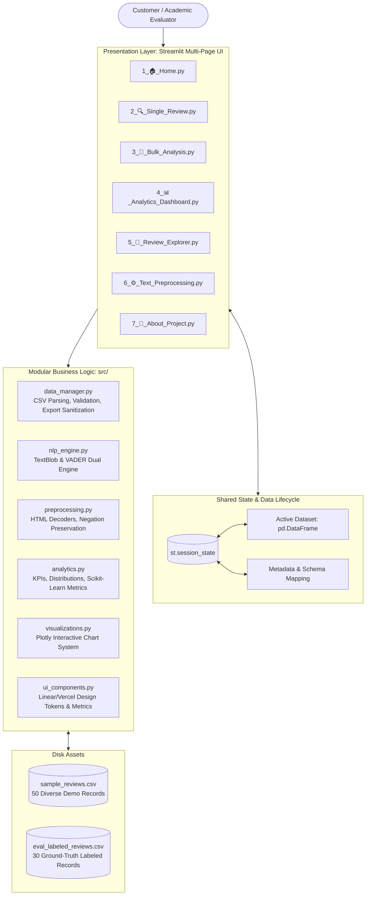

# ReviewSense ⚡
### Enterprise-Grade Product Review Intelligence & Natural Language Processing Platform

[](https://www.python.org/)
[](https://streamlit.io/)
[](#8-nlp-methodology--algorithms)
[](#16-automated-testing)
[](#credits--license)

---

## 1. Project Overview

**ReviewSense** is an advanced, production-grade Natural Language Processing (NLP) intelligence platform designed to extract, analyze, cross-validate, and visualize customer sentiment from product reviews. Built with a refined Linear/Vercel-inspired SaaS aesthetic, ReviewSense replaces shallow mockups with authentic, mathematically grounded sentiment scoring using a **Dual-Engine Architecture (TextBlob + VADER)**.

The platform provides end-to-end functionality spanning real-time single review scoring, bulk CSV ingestion with automatic schema detection, multi-dimensional analytics dashboards, granular review exploration, educational preprocessing laboratories, and empirical academic benchmark evaluation.

---

## 2. Problem Statement & Academic Objectives

### Problem Statement
In modern consumer retail and e-commerce platforms, customer reviews are voluminous, unstructured, and dispersed across diverse touchpoints. Star ratings alone fail to capture nuanced qualitative dissatisfaction regarding specific product attributes (e.g. battery life, build quality, customer service responsiveness). Manual review analysis is cost-prohibitive, while uncurated heuristic tools misinterpret negation, sarcasm, and domain idioms.

### Core Objectives
1. **Accurate Sentiment Extraction**: Quantify sentiment using dual mathematical dimensions: **Polarity** ($[-1.0, +1.0]$) and **Subjectivity** ($[0.0, 1.0]$).
2. **Dual-Lexicon Cross-Validation**: Compare Pattern-based semantic orientation (**TextBlob**) against rule-based valence scoring (**VADER**) to identify consensus and linguistic divergence.
3. **Data Integrity & Non-Destructive Processing**: Retain original raw text, preserve user row order, and protect spreadsheet exports against CSV Formula Injection.
4. **SaaS-Grade Visual Telemetry**: Deliver interactive cross-filtering across categories, products, ratings, and polarity corridors with Plotly visualizations.
5. **Academic Benchmarking**: Provide empirical classification metrics (Accuracy, Macro Precision, Recall, F1, Confusion Matrix) against human-labeled ground truth datasets.

---

## 3. Key Features

- **Executive Landing Hub**: Real-time KPI cards, sentiment donut and volume charts, active dataset preview, and one-click quick actions.
- **Single Review Intelligence**: Instant NLP inference with polarity precision gauges, subjectivity spectrum bars, VADER score breakdowns, and session history tracking.
- **Bulk CSV Analysis & Ingestion**: Drag-and-drop uploader supporting UTF-8, UTF-8-BOM, and Latin-1; automatic candidate column suggestion; non-destructive batch scoring.
- **Interactive Analytics Dashboard**: Cross-filter by sentiment class, product category, product name, polarity range, and search text; rating vs. sentiment cross-tabulation; timeline trends; extreme reviews telemetry.
- **Review Explorer**: Sortable, filterable, paginated review table with keyword search and CSV export.
- **NLP Preprocessing Laboratory**: Interactive step-by-step lexical pipeline visualization demonstrating HTML unescaping, whitespace collapsing, tokenization, and **negation-aware stopword filtering** (preventing sentiment inversion).
- **Academic Specifications & Viva Guide**: In-depth theoretical documentation, system architecture diagram, live ground-truth model evaluation, and top 10 viva defense questions.

---

## 4. System Architecture



---

## 5. Technology Stack

| Layer | Technology | Version | Purpose |
|---|---|---|---|
| **Runtime** | Python | 3.12 (CPython) | Production-grade language environment |
| **Framework** | Streamlit | 1.35 - 1.66 | Reactive multi-page web application framework |
| **Data Engine** | Pandas & NumPy | 3.1+ / 2.5+ | High-performance tabular manipulation and vectorization |
| **NLP Engine** | TextBlob & NLTK | 0.20+ / 3.10+ | Semantic polarity, subjectivity, and VADER valence scoring |
| **Visualizations** | Plotly | 7.1+ | Interactive SVG/WebGL charts adhering to design tokens |
| **Model Evaluation** | Scikit-Learn | 1.9+ | Macro Precision, Recall, F1, and Confusion Matrix calculation |
| **Testing** | Pytest | 9.2+ | Automated unit, regression, integration, and smoke tests |

---

## 6. Directory Structure

```
ReviewSense/
├── .streamlit/
│   └── config.toml                  # Dark theme tokens, server options, upload boundaries
├── app.py                           # Application entry point & executive dashboard
├── pages/
│   ├── 1_🏠_Home.py                # Page 1: Executive Landing Summary
│   ├── 2_🔍_Single_Review.py       # Page 2: Single Review Real-Time Intelligence
│   ├── 3_📁_Bulk_Analysis.py       # Page 3: CSV Dataset Upload & Ingestion
│   ├── 4_📊_Analytics_Dashboard.py # Page 4: Interactive Analytics & Cross-Filtering
│   ├── 5_🔎_Review_Explorer.py     # Page 5: Paginated Review Detail Inspector
│   ├── 6_⚙️_Text_Preprocessing.py  # Page 6: NLP Preprocessing Laboratory
│   └── 7_📖_About_Project.py       # Page 7: Academic Documentation & Model Evaluation
├── src/
│   ├── __init__.py
│   ├── config.py                    # Central configuration, thresholds, design tokens
│   ├── data_manager.py              # CSV parsing, schema detection, formula sanitization
│   ├── nlp_engine.py                # TextBlob & VADER dual analyzer implementations
│   ├── preprocessing.py             # HTML cleaning, negation-aware stopword removal
│   ├── analytics.py                 # KPI aggregation, distributions, benchmark metrics
│   ├── visualizations.py            # Plotly interactive chart generators
│   └── ui_components.py             # Reusable UI widgets, cards, badges, and layout CSS
├── sample_data/
│   ├── sample_reviews.csv           # 50 diverse demo reviews across 6 product categories
│   └── eval_labeled_reviews.csv     # 30 ground-truth human-labeled benchmark reviews
├── tests/
│   ├── __init__.py
│   ├── test_nlp_engine.py           # NLP unit tests (ranges, boundaries, edge cases)
│   ├── test_preprocessing.py        # Preprocessing tests (negation preservation)
│   ├── test_data_manager.py         # CSV tests (empty, encodings, injection protection)
│   ├── test_analytics.py            # Exact KPI calculation & denominator tests
│   ├── test_pages_smoke.py          # Streamlit AppTest headless smoke tests for all pages
│   ├── test_regression.py           # Regression tests (nst error, path resolution)
│   └── test_e2e_workflow.py         # End-to-end integration pipeline tests
├── .gitignore
├── requirements.txt                 # Pinned compatible production dependencies
├── Dockerfile                       # Production container specification with non-root user
└── README.md                        # Academic and operational documentation
```

---

## 7. NLP Methodology & Algorithmic Rules

### TextBlob Formulation
TextBlob computes sentiment by analyzing the semantic orientation of individual words and modifiers using an internal lexicon:
- **Polarity ($P$)**: Real value in $[-1.0, +1.0]$.
  $$\begin{cases} P > +0.05 & \implies \textbf{Positive} \\ P < -0.05 & \implies \textbf{Negative} \\ -0.05 \le P \le +0.05 & \implies \textbf{Neutral} \end{cases}$$
- **Subjectivity ($S$)**: Real value in $[0.0, 1.0]$.
  - $S \le 0.35$: Factual, objective assertions with minimal emotion.
  - $0.35 < S < 0.65$: Mixed factual and subjective opinion.
  - $S \ge 0.65$: Highly subjective, emotional, or opinionated prose.

### VADER Formulation
VADER evaluates valence incorporating grammatical heuristics (capitalization, exclamation marks, emoticons, and negation modifiers):
$$c = \frac{\sum x}{\sqrt{(\sum x)^2 + 15}}$$
$$\begin{cases} c \ge +0.05 & \implies \textbf{Positive} \\ c \le -0.05 & \implies \textbf{Negative} \\ -0.05 < c < +0.05 & \implies \textbf{Neutral} \end{cases}$$

### Negation Preservation in Preprocessing
Standard NLP pipelines indiscriminately drop stopwords, converting:
> *"The display is not good at all"* $\longrightarrow$ *"display good"*
This inverts sentiment from **Negative** to **Positive**. ReviewSense enforces a **Negation-Aware Stopword Filter**, safeguarding 27 critical negation tokens (`not`, `never`, `no`, `without`, `hardly`, `scarcely`, `barely`, `can't`, `isn't`, etc.).

---

## 8. Installation & Setup

### Prerequisites
- Python 3.10, 3.11, or 3.12 installed.

### Option A: Local Virtual Environment Setup

#### On Windows (PowerShell / Command Prompt):
```powershell
# Navigate to the project directory
cd ReviewSense

# Create virtual environment
python -m venv .venv

# Activate virtual environment
.\.venv\Scripts\Activate.ps1
# (or in Command Prompt: .\.venv\Scripts\activate.bat)

# Upgrade pip and install dependencies
python -m pip install --upgrade pip
python -m pip install -r requirements.txt

# Download required NLTK corpora
python -c "import nltk; nltk.download('vader_lexicon'); nltk.download('punkt'); nltk.download('punkt_tab'); nltk.download('stopwords')"
```

#### On macOS / Linux:
```bash
# Navigate to project directory
cd ReviewSense

# Create virtual environment
python3 -m venv .venv

# Activate virtual environment
source .venv/bin/activate

# Upgrade pip and install dependencies
pip install --upgrade pip
pip install -r requirements.txt

# Download required NLTK corpora
python -c "import nltk; nltk.download('vader_lexicon'); nltk.download('punkt'); nltk.download('punkt_tab'); nltk.download('stopwords')"
```

---

## 9. Launching the Application

Execute Streamlit from the activated virtual environment:

```bash
python -m streamlit run app.py
```

Or invoke the binary directly:
- **Windows**: `.\.venv\Scripts\python.exe -m streamlit run app.py`
- **macOS/Linux**: `./.venv/bin/python -m streamlit run app.py`

Once launched, navigate your browser to:
```
http://localhost:8501
```

---

## 10. Automated Testing Suite

ReviewSense includes an automated test suite comprising **36 comprehensive test cases** covering NLP accuracy, preprocessing, data ingestion, formula injection defense, page smoke tests, and regression guards.

Run all tests via pytest:
```bash
pytest -v
```

### Verified Test Categories:
1. `tests/test_nlp_engine.py`: Validates positive, negative, neutral, empty, whitespace, and exact threshold boundaries ($\pm 0.05$).
2. `tests/test_preprocessing.py`: Validates HTML entity decoding, whitespace collapsing, and negation preservation in stopwords.
3. `tests/test_data_manager.py`: Validates UTF-8, BOM encodings, empty byte detection, candidate column mapping, and CSV injection protection.
4. `tests/test_analytics.py`: Validates mathematical KPIs, denominators, category aggregations, and Scikit-Learn evaluation metrics.
5. `tests/test_pages_smoke.py`: Headless Streamlit `AppTest` verifying all 7 pages render with 0 runtime exceptions.
6. `tests/test_regression.py`: Verifies elimination of previously reported defects (`nst` NameError, relative path resolution, and navigation availability).
7. `tests/test_e2e_workflow.py`: End-to-end integration pipeline simulation.

---

## 11. Security, Privacy & Reliability

1. **CSV Formula Injection Mitigation (OWASP CSV Injection)**:
   Any string starting with dangerous spreadsheet formula triggers (`=`, `+`, `-`, `@`, `\t`, `\r`) is prepended with a single apostrophe (`'`) upon export, neutralizing malicious code execution in Excel or Google Sheets while preserving legitimate numeric scores.
2. **Local NLP Execution**:
   All text processing is executed entirely within the local Python runtime without external cloud API calls, guaranteeing customer privacy and data isolation.
3. **Session State Isolation**:
   Data uploaded during a user session is scoped strictly to that session's state; no data leaks across sessions or persists unencrypted on disk.
4. **Non-Destructive Ingestion**:
   Rows with empty or non-string reviews are marked as `Empty/Invalid` and retained, preventing silent data deletion or row order distortion.

---

## 12. Viva Voce Defense Preparation

| # | Question | Academic Answer Summary |
|---|---|---|
| **1** | *What is the difference between Polarity and Subjectivity?* | Polarity measures emotional valence ($-1.0$ negative to $+1.0$ positive). Subjectivity measures factual objectivity ($0.0$) versus opinionated/emotional prose ($1.0$). |
| **2** | *Why use both TextBlob and VADER?* | TextBlob uses a pattern dictionary averaging sentiment orientation. VADER uses heuristic rules tuned for social feedback, accounting for punctuation (`!`), capitalization (`GREAT`), and emoji valence. |
| **3** | *Why preserve negation in stopword removal?* | Dropping stopwords like *"not"* inverts valence (*"not good"* becomes *"good"*). ReviewSense protects 27 negation particles. |
| **4** | *Why use $\pm 0.05$ threshold boundaries?* | A zero-width boundary is vulnerable to lexical noise where mildly descriptive words produce tiny non-zero floats. A neutral corridor $[-0.05, +0.05]$ stabilizes classification. |
| **5** | *How is CSV Injection prevented?* | Exported text starting with `=`, `+`, `-`, or `@` is prepended with `'` to neutralize spreadsheet execution. |

---

## 13. Docker Deployment

Build and run ReviewSense in an isolated, secure container:

```bash
# Build Docker image
docker build -t reviewsense:2.0.0 .

# Run container on port 8501
docker run -d -p 8501:8501 --name reviewsense_app reviewsense:2.0.0
```

Access the application at `http://localhost:8501`.

---

## 14. Academic Credits & Acknowledgments

- **Lead Development**: ReviewSense Engineering Team
- **NLP Libraries**: [TextBlob](https://textblob.readthedocs.io/), [NLTK VADER](https://www.nltk.org/)
- **UI & Analytics**: [Streamlit](https://streamlit.io/), [Plotly](https://plotly.com/python/)
- **License**: MIT Open Source Academic License
